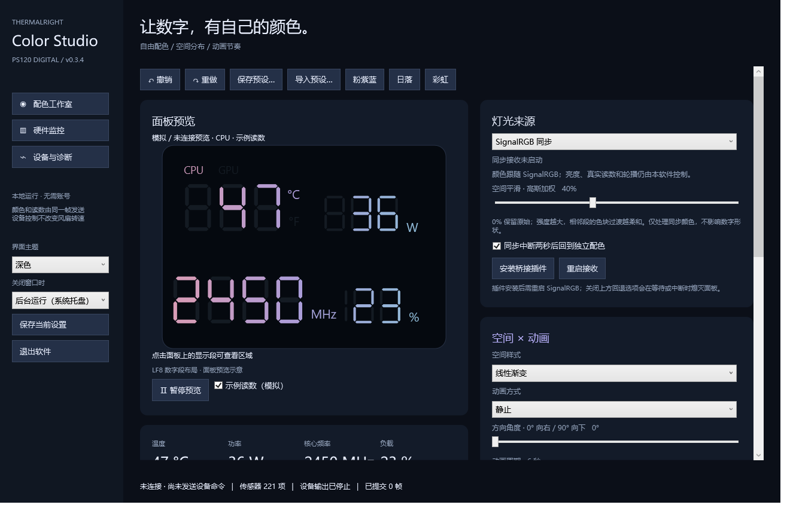

# Thermalright Color Studio

A Windows color and monitoring studio for the Thermalright PS120 DIGITAL / LF8 segmented display.

[中文](README.md) · [Download](https://github.com/febtsuki/thermalright-color-studio/releases/latest) · [SignalRGB setup](docs/SignalRGB.md)



This independent GPL-3.0 project is not affiliated with Thermalright or SignalRGB. It is an early preview validated on one LF8 panel, not a universal replacement for every TRCC device.

## Features

Custom 1–16 color palettes, arbitrary-angle gradients, radial/mirrored/conic effects, stripes, per-metric zones, animation and temperature/load effects. Includes an HSV wheel with a saturation/value square, HEX/RGB editing, light/dark themes, presets, undo/redo and tray operation.

Displays real CPU/GPU temperature, power, clock and load, with source rotation and Celsius/Fahrenheit support. SignalRGB integration forwards global lighting while Color Studio retains real numeric masks. Adjustable spatial Gaussian smoothing softens abrupt color transitions between segments.

## Run

Validated on Windows 11 x64, PS120 DIGITAL with USB `0416:8001`, handshake `PM=49 / SUB=96`, LF8 93-segment layout, and SignalRGB 2.5.74. An identical USB ID alone does not establish compatibility.

Download the portable ZIP from Releases, extract it to a writable directory, completely exit TRCC, and run `ThermalrightColorStudio.exe`. The .NET runtime is bundled. Administrator privileges and separately installed [PawnIO 2.2.0](https://github.com/namazso/PawnIO.Setup/releases/tag/2.2.0) are required for low-level CPU sensor access. No driver is bundled or automatically installed.

Settings live in `data/` beside the EXE. Copy that directory when upgrading. Unknown layouts are rejected; unavailable readings are left blank. There are no PWM or firmware controls. Full sleep/disconnect recovery is not yet implemented.

For optional sign-in startup, run `Manage-Autostart.ps1` in PowerShell. It registers a highest-available-privilege interactive task for the current user, delayed 15 seconds after sign-in. Append `-Disable` to remove it. Re-register after moving the application directory. Startup currently opens the main window; closing can send it to the tray.

## Build and test

Use Windows x64 and .NET SDK 10.0.401:

```powershell
./build.ps1
dotnet ./src/ThermalrightColorStudio/bin/Release/net10.0-windows/win-x64/ThermalrightColorStudio.dll --self-test ./test-results.txt
```

The portable app is produced in `publish/`. There are 40 automated checks; see [validation](docs/Validation.md) for their scope and actual hardware observations. Dependencies are locked in `packages.lock.json`.

## Credits

GPL-3.0. LF8 coordinates, masks and wire mapping are adapted from [thermalright-trcc-linux](https://github.com/Lexonight1/thermalright-trcc-linux). See [third-party notices](THIRD-PARTY-NOTICES.md) for attribution, dependency licenses and exact upstream source revisions. No original TRCC binary, proprietary library or decompiled source is distributed.
